# Nocturne

> 换上下文/交接：先读 **[HANDOFF.md](HANDOFF.md)**，里面有状态、口径、坑和下一步。 · 夜航

一个把「听歌」当成「看一场演出」的网页播放器。

打开就是一整张深灰的纸：纸里嵌着一块**#262626 的取景框**，框里浮着一颗用半调点画出来的心，低频把它撑大、鼓点从圆心推出一圈涟漪，歌词浮在框的正中，逐字亮起。鼠标划过纸面时，45° 的网点会沿着手走过的路径被擦出来，停手再缩回纸里。没有封面、没有列表、没有进度条以外的装饰。

对标 [Mineradio](https://github.com/XxHuberrr/Mineradio) 的表现形式，但完全跑在浏览器里：**零依赖、纯静态、本地文件不上传**。

> 本项目仅供个人学习使用，不提供音乐内容，不绕过付费/版权限制。网易云相关能力需要你使用自己的账号 Cookie，不能把 Cookie 提交到仓库。

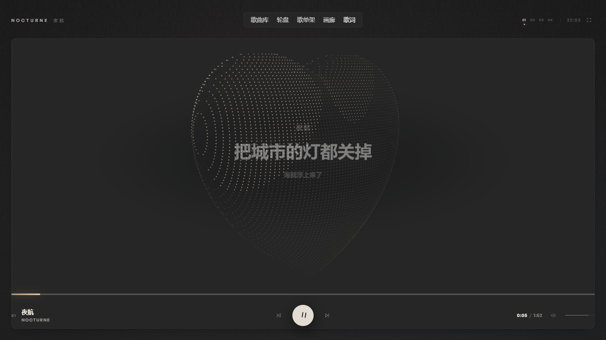

## 跑起来

```bash
cd nocturne
npm start          # http://127.0.0.1:4173/
```

不要双击 `index.html`。因为用了 ES modules 和 `fetch` 读取歌词，`file://` 协议会被浏览器拦住。

### 安装成桌面 App（PWA）

```bash
npm start          # 先启动本地服务
```

然后用 Chrome / Edge 打开 `http://127.0.0.1:4173/`，点地址栏右侧的「安装」图标，
或者菜单 →「安装 Nocturne」。安装后会以独立窗口运行，有开始菜单/桌面图标。

- `manifest.webmanifest` + `sw.js` 缓存 UI、字体和三首 demo
- `/api/` 不经过 Service Worker，网易云登录和音频永远走本地 Node 服务
- 调试时访问 `?sw=0` 会注销 Service Worker，避免缓存干扰
- PWA 仍需本地 `node server.js`；它不是 Electron，不依赖 Chromium 外壳

### 分享给朋友

分享包不包含 `.netease-session.json`。朋友需要：

1. 安装 Node.js
2. 解压分享包，双击 `start.cmd` 或执行 `node server.js`
3. 打开 `http://127.0.0.1:4173/`
4. 用自己的网易云 Cookie 登录
5. 按上面的方式安装成 PWA

每个人使用自己的账号和本地数据；不要把 GitHub 仓库里的 Cookie 文件一起发出去。

> 首次进入要点一下「进入」——浏览器只允许用户手势之后播放声音。

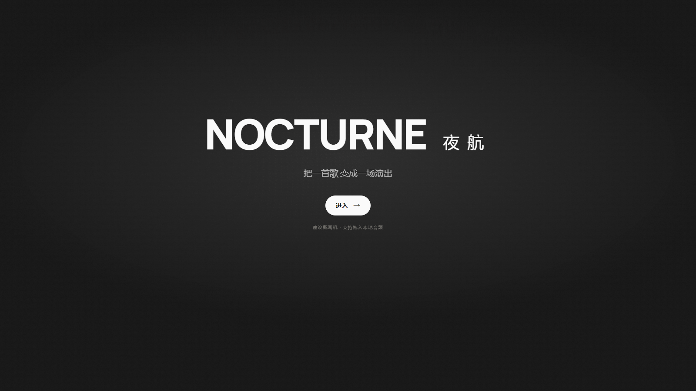

开场是 p1 的版式：Manrope 800 的 NOCTURNE + 夜航、20px 副题、白色胶囊「进入 →」；字体文件在
`vendor/fonts/manrope-var.woff2`，不连 CDN。

## 网易云登录

右上角「登录」打开扫码框。二维码由 `server.js` 向网易云申请。登录 Cookie 保存在本机
`nocturne/.netease-session.json`（文件权限 0600，静态服务不会暴露 dotfile），**重启服务后自动恢复**。
这个版本**不需要浏览器扩展**；登录后可以继续搜索和播放网易云。

如果扫码被网易云拦截（提示“请切换其他登录方式或升级新版本再试”）：这是网易云侧的风控，
网页扫码经常无法通过。点「Cookie 登录」，在 `music.163.com` 登录后把 `MUSIC_U` 粘进去，
**只需要做一次**；也可以启动时设置 `NOCTURNE_NETEASE_COOKIE` 环境变量。
Cookie 等于账号凭据，不要提交、不要发给别人，也不要让 `server.js` 监听公网。

登录后打开「歌曲库」，在“网易云”搜索框里搜歌，点结果会直接加入队列并播放；歌词、封面和时长一起带过来。
播放地址由本机 `server.js` 代理（支持 Range 拖动），VIP/版权/地区限制的歌会提示没有可播放地址。

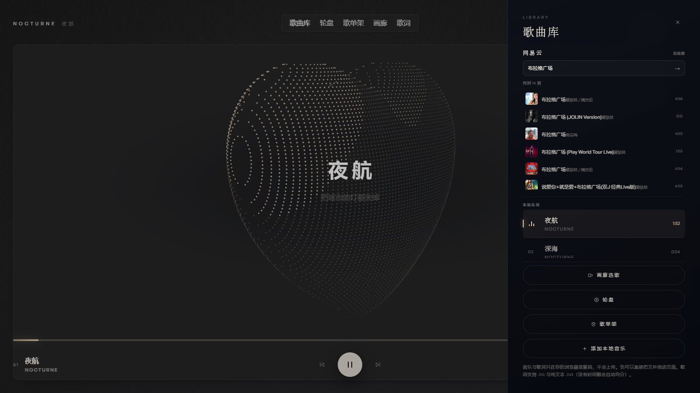

> 非官方登录接口，只建议本机个人使用；不要把带登录状态的 `server.js` 暴露到公网。

## 现在能做什么

| 能力 | 说明 |
| --- | --- |
| 沉浸舞台 | 一颗由 Taubin 隐式曲面解出的波点之心：半调三档、弹性旋转、低频撑大、鼓点推波、可拖拽甩动 |
| 开场 | p1 版式：Manrope 800 的 NOCTURNE 夜航、20px 副题、白色胶囊「进入 →」 |
| 舞台取景框 | p3 参数直搬：`#262626` 面板、12px 圆角、1px 边、30px 边距；HUD/nav 在外，播放区在内 |
| 顶部导航 | p3 同款 navpill（40px / 16px）：歌曲库、轮盘、歌单架、画廊、日推 |
| 网易云登录 | 右上角登录 → 二维码扫码；Cookie 存在本机 `.netease-session.json`，重启自动恢复，不依赖扩展 |
| 网易云搜索 | 歌曲库抽屉里搜歌，点结果直接进队列；音频走本机代理，支持进度拖动 |
| 歌曲库 | 搜索添加、逐行删除、展示当前队列；内置 3 首测试曲 |
| 轮盘 | 圆弧歌词 + 右侧封面堆，拖动整摞切歌 |
| 画廊 | 选中歌单的每首封面，裸图斜向叠层；悬停右上滑出 + 拖动翻阅 |
| 日推 | 网易云每日推荐，载入歌曲库 |
| 纸面波点 | 整站 #1e1e1e 纸面 + p2 同款颗粒；鼠标拖出一串 45° 半调点带，约 0.9s 缩回，`?dots=0` 关闭 |
| 自定义光标 | 奶油纸点 + 细圆环；按钮/封面悬停时圆环放大，输入框恢复系统光标，`?cursor=0` 用回原光标 |
| 视觉预设 | 4 个房间，配色/密度/拖影/运镜/歌词全部联动，600ms 内插值过渡，不重建任何缓冲 |
| 声音驱动 | FFT 分频 + 自适应低音鼓点检测；鼓点只给一次 600ms 冲量，不逐帧追频谱。心和光柱共用这份节拍 |
| 切换视觉 | `H` 在心与旧的尘埃场之间切换；`?heart=0` 直接关闭心 |
| 歌词舞台 | LRC 解析、逐字填充、上下句渐隐、自动切行、隐藏/显示 |
| 卡片堆 | 轮盘右侧三张封面叠成一摞，上下拖整摞换歌，松手带惯性、环绕队列 |
| 播放 | 本地音频（拖入文件或整个文件夹）、进度拖动、音量、整张专辑顺序播放 |
| 播放键 | 保留原来的奶油圆钮；播放时两根暂停竖线会随鼠标平移/倾斜，暂停时回到三角 |
| 歌单架 | 读网易云账号的歌单；选「我喜欢的音乐」等，歌曲库换成该歌单 |
| 标签 | 自己解析 ID3v2：标题、艺术家、专辑、音轨号、内嵌封面，读不到才退回文件名 |
| 歌词配对 | 同名 `.lrc` 自动跟音频配对；拖入歌词也能给当前曲目套上 |
| 队列 | 右侧玻璃抽屉，播放中的曲目有跳动的小电平条 |
| 细节 | 全屏、Media Session（系统媒体键）、空闲时只隐底部控制（顶部 nav 常驻）、移动端适配、`prefers-reduced-motion` |
| 兜底 | 没有 WebGL2 时保留排版与播放功能，只是没有心与粒子 |

内置 **3 首演示曲**：全部由 `tools/make-demos.mjs` 现场合成——加法合成 + 施罗德混响，无采样、无版权问题。三首是三个不同的房间：A 小调 9、D 小调 9、C 大调 9。只有第一首《夜航》带歌词，其余留白，用来展示"纯音乐"状态。封面同样是画出来的（`tools/make-covers.mjs`，960×540），写进各自的 ID3 APIC 帧，所以文件自己带着封面，刷新、换机器都还在。

### 那颗波点之心是怎么来的

舞台中央是一颗用数学解出来的心，不是贴图：**Taubin 隐式曲面**
`(x² + 9/4·y² + z² − 1)³ − x²z³ − 9/80·y²z³ = 0`。

方程不能直接画，只能“解”：对 x–z 平面上的每个格子，把方程看成“这里有多厚”，
从 y=0 往外找符号翻转，再二分 22 次，得到 ±y 两个点；解析梯度 ∇F 顺便给出法线。
126×150 的网格解出约 9 千个点，只在载入时算一次。之后每帧很便宜：绕竖轴转、
透视投影（焦距 1500）、画一个点精灵。

- **印刷感**——背面剔除 + 固定方向光，把点分成三档不透明度（0.42 / 0.68 / 1）；
  点的大小只跟深度走，不跟亮度走。所以明暗是靠密度和透明度读出来的，像半调印刷。
- **弹性**——每个同心环按 `1/(0.72 − 0.38r)` 的速度追当前转角，外圈永远慢半拍；
  甩起来像整颗心在“化开”，而不是一个刚体。
- **音乐律动**——低频把整颗心撑大，鼓点再补一次更快的收缩；每一下鼓点还会从圆心
  推出一圈位移波，高频让点心轻微闪烁。
- **手感**——按住拖动 = 给角速度，松手后按 2 秒半衰期滑行，最后自己回到三分之四视角。

原来的尘埃场没有删，只是默认让位（按 **H** 随时换回来；`?heart=0` 直接关闭）。
它还在 `js/stage.js` 里保留着三层景深、curl 流场和光柱，切换时从干净的拖影开始。


### 舞台取景框

主舞台不是铺满整页：它是一块 **内嵌的取景框**，参数直接量自 p3 的 heart lab——框内 `#262626`、
1px `rgba(247,247,247,.06)` 边、12px 圆角、`0 12px 30px -18px rgba(0,0,0,.55)` 的落影；
框内 inset 30px、顶 102px、底 30px。框外才是 #1e1e1e 的纸。

所以取景框其实比纸**略亮**（30,30,30 → 38,38,38），层次靠边框和落影，而不是靠压黑。
进度、播放键、曲目信息都落在框内底部（p3 的下方控制区），顶栏和 nav 在框外的纸边上。

顶栏中间是 p3 同款 **navpill**：40px 高、`#262626`、6px 圆角、16px 字、`4px 10px` 内边距、
`-0.32px` 字距；五项换成我们的视图——**歌曲库 / 轮盘 / 歌单架 / 画廊 / 日推**。
「歌曲库」就是原来的 L（队列抽屉）；「日推」直接载入网易云每日推荐。

这么切还有一个原因：以后新的表现形式（比如 p2 的列表/卡片）可以放在框外的纸边上，不会和舞台抢。
按 `H` 切回尘埃场时取景框会淡出，让旧的整屏舞台回来。

### 纸面与波点

背景不是纯黑：是一整张 **#1e1e1e 的纸**。颗粒直接搬了 p2（carterogunsola.com）那张
160px 的 `feTurbulence` 噪点——`baseFrequency .75`、`numOctaves 2`、alpha `0.034`，
`body::before` 铺满整页，全屏视图各自再铺一层 `var(--grain)`。放大看是细砂，不是纯色。

鼠标在纸面上划过时，纸里的 **45° 半调网点**会沿路径被“擦”出来：慢慢拖是一条清晰的点带，
快划是一条散开的点尾，停手后约 **0.9 秒**缩回纸里。点击还会从指尖推开一圈由点组成的环。
这不是粒子，是真实的网点屏（13px 间距）被一个低分辨率 wake 当遮罩显影——和那颗心
用的是同一种印刷语言。`?dots=0` 可以关掉；系统开了「减少动态效果」时它默认不启用。

这层网点不是盖在页面上的：它跟着当前视图走（开场幕布 → 舞台 → 轮盘/歌单架/画廊），
画在那张视图的纸面上、内容下面，所以卡片、歌词、按钮永远盖在它上面；切视图时 trail 会清空重来。
在主舞台上，点还会被**心形轮廓挖掉**，所以拖过心时点带会从心边上绕过去，不会盖在心上。

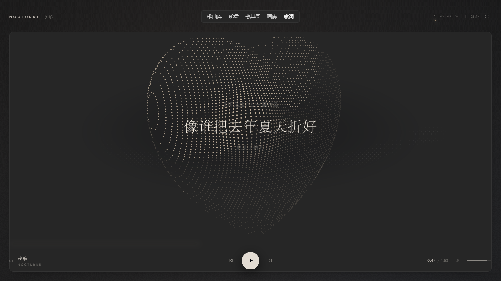

### 歌单架

按 `S`，或点顶部的「歌单架」。这里读的是**你网易云账号里的歌单**，不是本地队列；卡片是玻璃材质。**只有拖动、滚轮或方向键才移动架子**——鼠标只悬停不会把卡片推走，方便点中歌单。

打开时先显示「正在读取你的歌单…」的加载状态，不会先摆一个假歌单；数据回来后才换成真正的卡片。整个架子从右侧轻轻推进来，不再叠一层全屏 backdrop-filter，封面也只取 `?param=420y420` 的小图，打开比之前轻很多。

点任意一张歌单，会读取它里面的曲目并**替换歌曲库的队列**，但不会自动拉开右侧歌曲库；墨点铺满后回到主页面，第一首会被装进播放器但先不自动播。

加载时从点击位置扩散一颗和页面同色的墨点，半径跟真实加载进度走，铺满屏幕才切换到歌单；歌曲库随后从同色底里浮现。按 `Esc` 可取消。

> 公开仓库里没有带真实账号的歌单架截图，避免暴露个人歌单；本地运行效果完全一致。

没有封面的歌单会用名字首字 + 标题哈希出的暗色作占位，不会出现灰图。

### 画廊（选歌）

按 `G`，或点顶部的「画廊」。读的是**当前队列**——也就是你刚从歌单架选中的那个歌单，每一首歌的封面都会被排进一叠斜向的裸图里，不再只取前 10 首。拖动、滚轮或 `←` `→` 翻阅，点击任意一张播放。

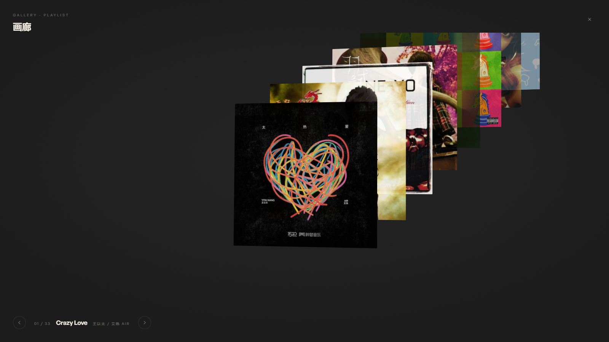

背景和主体一样是深灰纸面；卡片是裸图平面，无边框、无编号，只有叠影和透明度。鼠标移动会带一点视差；**鼠标停在某张封面上，它会向右上方滑出一点，离开后归位**。拖拽/滚轮翻页，点击播放。画廊用固定 9 张卡池循环复用，封面按 `?param=420y420` 取小图，几百首的歌单也只保留 9 个 DOM 和 7 张图，不会一次拉几百张原图。

### 轮盘（歌词 + 封面）

字体是 **General Sans**（Fontshare，个人与商用免费，已下载到 `vendor/fonts/`，不依赖 CDN）；中文交给系统的苹方 / 微软雅黑粗体。没有去扒 Carter 那套 Oracle——它是商用字体，而且**没有中文字形**（他站点自己的中文导航就是乱码），扒下来中文只会回退得更丑。

右侧是**三张封面叠成的一摞**：当前那首在中间，上一首、下一首各露出大半，带一点 6° 倾斜和透视。滚到队首/队尾会绕回另一端，所以永远有上、下两张可以够到。

**上下拖动整摞就是切歌**：卡片跟着手指走，松手后带一点惯性滑到最近的一张；也可以直接点相邻的封面，或在卡片上滚轮。换歌后文字滚筒再滚一格。原来的「面板内翻转 / 波纹」整套拿掉了——换歌现在是这一摞在动，不是在框里做特效。

卡片文字是**滚筒**：`N°03 / 06`、曲名、`歌手 · 歌词 07/16 · 0:38` 三行各放两份副本，切歌时竖直滚一格（200ms）。

卡片是玻璃：半透明渐变 + 内缘高光 + 一道掠过表面的镜面反光 + 柔光托底；当前那张的边框会更亮一点。底部那条曲线是**实时频谱**（真的接了 `AnalyserNode`），暂停时退化成一条很轻的呼吸线，只画在当前这张上。

按 `W`。**同一段圆弧，现在装的是歌词**：正在唱的那一句停在中心亮着，上下几句按同样的曲率转过去，越远越淡。它跟着歌自己走；你拖开之后会停 4 秒，然后重新追上当前句。点任意一行直接跳到那一句。

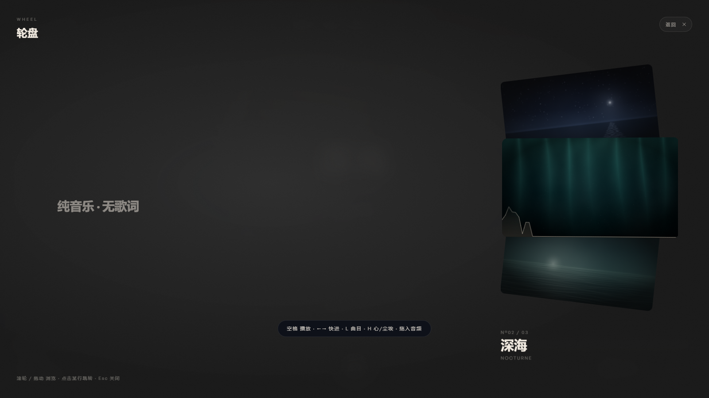

弧线的算法没变——半径 1700px、圆心在屏幕左侧外面——只是把"歌名"换成了"句子"，字号从 74px 降到 38px。同一套几何，两种内容。

### 日推

顶部最右边的「日推」是原来那个空着的「歌词」按钮。点它会拉网易云当天的每日推荐（通常 30 首左右），**替换歌曲库队列**并打开歌曲库；第一首装进播放器但先不自动播。

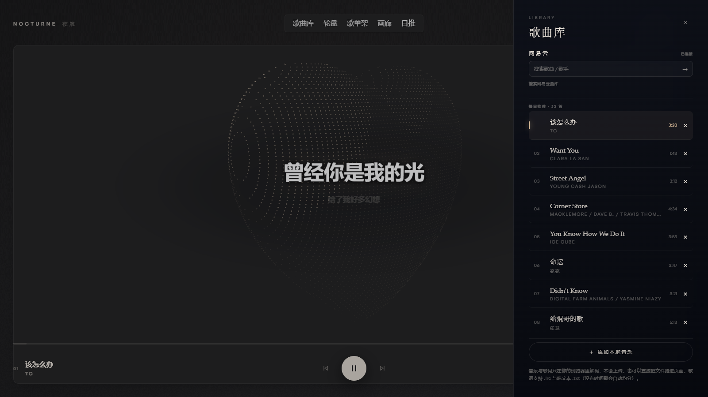

### 水波（实验页）

`http://127.0.0.1:4173/wave.html` —— 另一套完全不同的视觉语言：一张 120×120 的粒子水面，声波从中心一圈圈推出去。右上角可拖拽旋转视角。

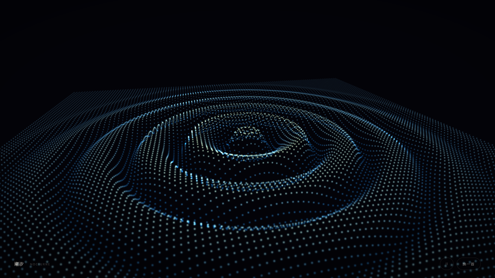

和主舞台的波点之心不同，这里把声音拆成四个慢变量喂给水面：

| 频段 | 变量 | 驱动什么 |
| --- | --- | --- |
| 30–160 Hz | bass | 波峰高度（外加每次鼓点 600ms 的冲量） |
| 160–2k Hz | mid | 涟漪密度，也就是一圈圈之间的间距 |
| 2k–12k Hz | treble | 波峰上的细碎闪烁，不抬高水面 |
| 全频 | level | 横向扩散速度 |

没有声音时，水面不会死：一个 0.34 的"呼吸"底噪接管振幅，你看到的是缓慢起伏的一整张网（[静音状态](shots/wave-calm.png)）。音频是 `<audio>` → `MediaElementSource` → `Analyser`（`fftSize` 1024，即 512 个频点）→ 目的地；`AudioContext` 在第一次点击时才创建并 `resume()`，绕开浏览器的自动播放限制。

Three.js 和 OrbitControls 已经放在 `vendor/` 里，不依赖 CDN，断网也能跑。

### 四种房间

顶栏 `01 02 03 04` 或键盘 `1`–`4` 切换。选择会存进 localStorage，下次打开还是这间。

| # | 预设 | 一句话 |
| --- | --- | --- |
| 01 | 夜航 | 暖金、心、标准密度——默认 |
| 02 | 深海 | 青蓝、长拖影、更密更小、镜头更慢 |
| 03 | 余烬 | 赤金、大颗粒、镜头更快、歌词更大 |
| 04 | 银盐 | 黑白、稀疏、重颗粒、重暗角 |

| | |
| --- | --- |
| 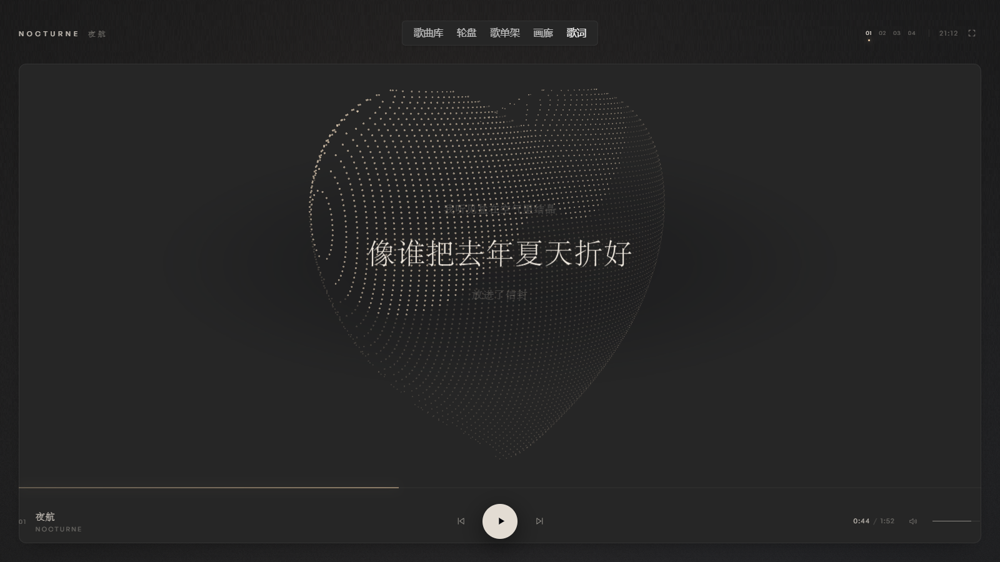 | 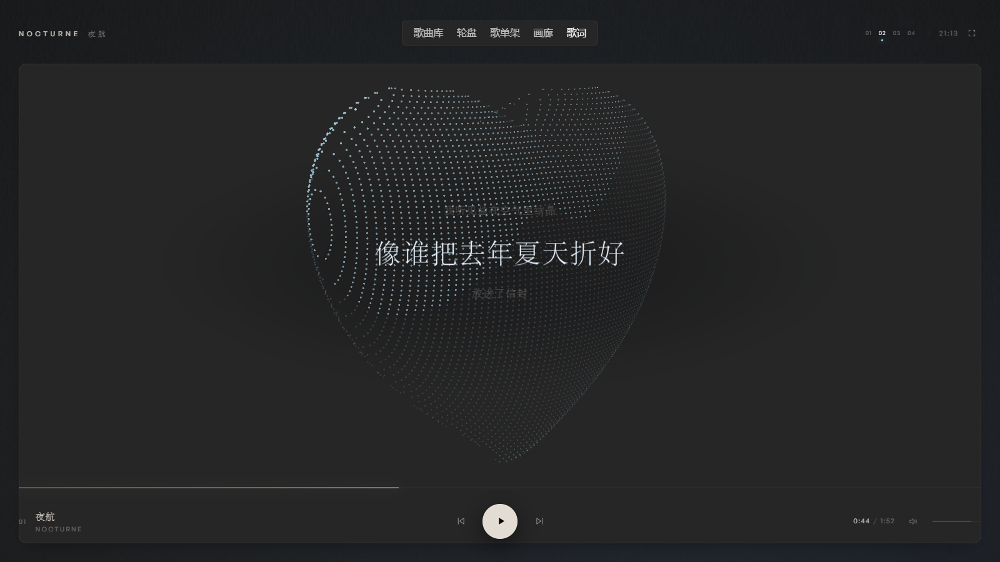 |
| 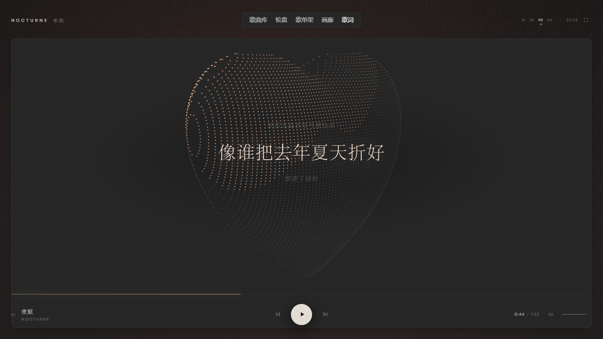 | 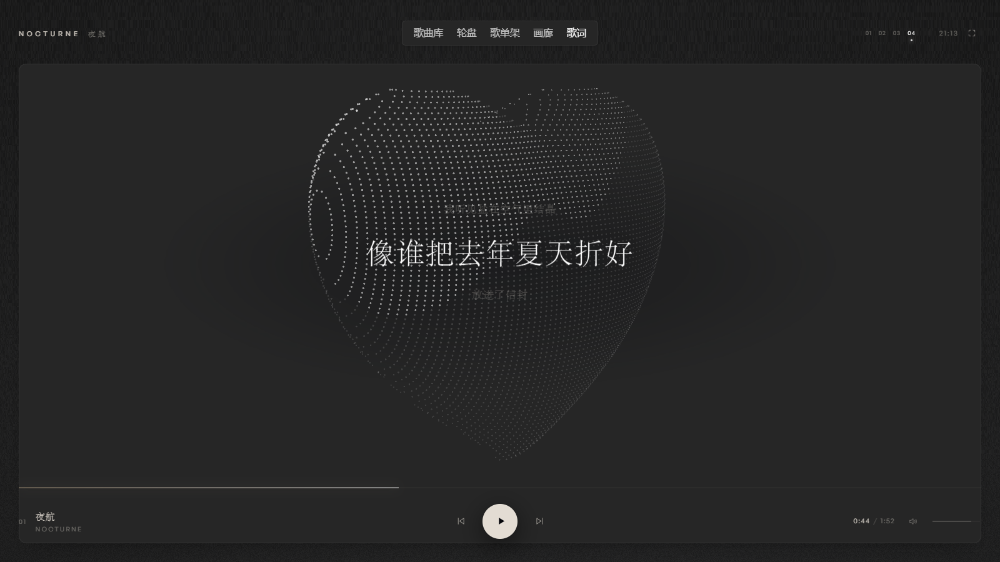 |

### 键盘

| 键 | 动作 |
| --- | --- |
| `Space` | 播放 / 暂停 |
| `←` `→` | 后退 / 前进 5 秒 |
| `↑` `↓` | 音量 |
| `1`–`4` | 切换视觉预设 |
| `S` | 歌单架 |
| `G` | 画廊选歌 |
| `W` | 歌词轮盘 |
| `L` | 曲目抽屉 |
| `M` | 静音 |
| `F` | 全屏 |
| `Esc` | 关闭抽屉 / 歌单架 |

## 目录

```
nocturne/
├── index.html
├── wave.html         # 水波实验页（Three.js）
├── vendor/           # three.min.js · OrbitControls.js（本地化，无 CDN）
├── css/style.css
├── js/
│   ├── app.js        # 队列、时钟、歌词渲染、所有交互
│   ├── audio.js      # <audio> → Web Audio 图 → 频谱 / 鼓点
│   ├── stage.js      # WebGL2：背景 + 尘埃 + 拖影 + 运镜（按 H 可换回）
│   ├── heart.js      # WebGL2 点精灵：Taubin 曲面解出的波点之心 + 音乐律动
│   ├── paper-dots.js # 全屏纸面：45° 半调网点随指针 wake 显影
│   ├── shelf.js      # 3D 歌单架（DOM + CSS 3D，不走 WebGL）
│   ├── gallery.js    # 斜向叠图画廊（选中歌单的全部封面）
│   ├── wheel.js      # 圆弧歌词页 + 右侧三张封面的拖动堆叠
│   ├── presets.js    # 4 套视觉参数（改这里就够了）
│   ├── meta.js       # ID3v2 读取 + 文件名兜底（纯函数，可单测）
│   └── lyrics.js     # LRC 解析与时间轴（纯函数，可单测）
├── assets/
│   ├── demo-1 … 6.mp3  # 合成的演示曲，当前只用前 3 首；ID3 里带封面
│   ├── covers/         # 六张程序化封面：night / deep / tide / embers / silver / idle
│   └── demo.lrc        # 只有第一首带歌词
├── tools/
│   ├── make-demos.mjs # 演示曲合成器（加法合成 + 混响）
│   ├── make-covers.mjs # 封面画师（手写 PNG 编码，无 canvas）
│   ├── tag-demos.mjs  # 把标题/封面写进 ID3v2.3，并用 meta.js 回读校验
│   ├── probe-local.mjs # 抓切换中间帧
│   └── cdp.mjs        # 无头 Chrome 截图 / 探针（无依赖，走 CDP）
├── tests/            # lyrics.test.mjs · meta.test.mjs · demo-tags.test.mjs
├── shots/
├── server.js         # 支持 Range 的静态服务器
└── package.json
```

## 这一版刻意没做

- **舞台不显示封面**：整屏视觉就是封面，加一张小图反而会破掉氛围。封面只在歌单架里出现。
- **不做 FLAC 标签**：MP3 的 ID3v2 覆盖了绝大多数场景，FLAC / M4A 暂时走文件名。要补的话是往 `meta.js` 里加两个解析器，接口不变。
- **没有在线音源**：网易云 / QQ 音乐都要自建反向代理，且随时会挂。先把「体验」做对，音源最后接。
- **没有真正的 bloom 后处理**：现在是加法混合 + 拖影近似，够看，但下一步值得换成两 pass 的高斯模糊。

## 对标 Mineradio 的路线图

一步一步来，每一步都能单独验收。

### ① 视觉预设 ✅ 已完成
4 个槽位，每个槽位独立保存配色、粒子密度、运镜强度、拖影长度、歌词外观，切换时 600ms 插值过渡。
实现要点：粒子缓冲按**最大密度**一次分配，预设只决定「画多少个」；切换时一个 `lerpTree` 递归插值所有数字，颜色走 WebGL uniform，文字走注册过的 CSS 自定义属性（`@property`，所以浏览器会自己补间）。
实测（无头 SwiftShader，最差环境）：切换期间中位帧 16.6ms，p95 17.2ms。

### ② 3D 歌单架 ✅ 已完成
右键唤出，卡片在透视轨道上排列，滚轮 / 拖动 / 方向键浏览，点击或 Enter 播放。
实现要点：用 DOM + CSS 3D 而不是 WebGL——文字要清晰，而 60 张卡片的 `transform` 更新比 6 万个顶点便宜得多。每帧只改 `translate3d + rotateY + scale + opacity`，浏览器自己合批。
配套：ID3v2 解析（标题 / 艺术家 / 专辑 / 音轨号 / 内嵌封面）+ 按音轨号排序 + 整张专辑连续播放。

### ②b 尘埃重写 ✅ 已完成
把"均匀随机的点"换成"一束斜光里的尘埃"：三层景深、curl 流场、密度留白、世界空间的光柱（尘埃与背景共用同一条轴），鼓点冲量改成一次性 600ms。
实现要点：流场用 2D 无散度噪声，每个粒子每帧 4–6 次 simplex 采样；光柱在背景里用"视线与轴的最近距离"解析求出，所以没有粒子处也有光。
实测（1600×900，无头 SwiftShader）：3 万粒子下中位帧 16.7ms。真机 GPU 上还有余量，弱机可用 `?quality=low` 或预设的密度参数压。

### ②c 波点之心 ✅ 已完成
主舞台换成 Taubin 曲面解出的点云：背面剔除 + 三档半调、逐环弹性滞后、低频撑大、鼓点推一圈涟漪、可拖拽甩动。旧的尘埃场默认让位，按 `H` 召回。
实现在 `js/heart.js`；1600×900 无头环境 60fps，约 9 千个点。

### ③ 歌词升级（下一步）
逐字（增强 LRC / QRC / KRC）、双语对照、翻译行、间奏留白（长空白自动显示三点呼吸）。
验收：一首中文歌 + 一首英文歌 + 一段纯音乐都表现正常。

### ④ 天气电台
Open-Meteo + 定位，按天气与时段生成情绪匹配的队列；顺便让天气去挑预设（下雨切深海，黄昏切余烬）。
验收：同一首歌在不同天气下出现在不同队列里。

### ⑤ 长音频 / 播客模式
离线节拍网格分析（把整首歌的鼓点先算出来），视觉从「追高频」切到「跟人声和低频律动」。
验收：30 分钟的播客不会让画面乱抖。

### ⑥ 音源
自建代理接网易云 / QQ，做好失败降级。这一步放最后，因为它是最不可控的部分。

## 质量工具

```bash
npm test                                  # 19 个单测：歌词解析 + ID3 读取 + 演示曲封面
npm run build:assets                      # 合成演示曲 → 画封面 → 写进 ID3（一条龙）
npm run build:covers                      # 只重画封面
npm run build:tags                        # 只重新写标签（--check 可只校验不写）
node tools/cdp.mjs --url "http://127.0.0.1:4173/?still=1&t=21.5" \
     --out shots/stage.png --w 1600 --h 900
```

`cdp.mjs` 用 Node 自带的 `fetch` + `WebSocket` 直接驱动无头 Chrome：截图、执行 JS、回收 console 错误。没有 puppeteer。

调试参数：

| 参数 | 作用 |
| --- | --- |
| `?still=1&t=32` | 定格在某一秒，不播放，用合成频谱驱动视觉（截图用） |
| `?panel=1` | 自动打开曲目抽屉（配合 `still`） |
| `?shelf=1` | 自动打开歌单架（配合 `still`） |
| `?preset=abyss` | 指定开场预设：`nocturne` / `abyss` / `ember` / `halide` |
| `?quality=low` | 密度压到 32%，给弱机 |

### 封面怎么来

三种放法，优先级从高到低：

1. **内嵌 ID3**（最永久）：用 Mp3tag / foobar2000 把封面写进 APIC 帧，拖进来就自动显示。
2. **同名图片一起拖**：`苦茶子.jpg` + `苦茶子.mp3` 一起选中拖入，按基名配对；同批里放一张 `cover.jpg` 也会分配给所有曲目。
3. **单独拖一张图**：图片会直接盖到**当前播放的**那首歌上。

注意：拖进去的封面只在本次会话有效（blob URL），刷新就没了；要永久就写进 ID3。演示曲就是一个例子：`make-covers.mjs` 画图，`tag-demos.mjs` 写进 APIC 帧，播放时只用一个 Range 请求读标签头（约 300KB），不碰音频。

## 已知限制

- 歌词文件需要 UTF-8；GBK 的 `.lrc` 会乱码。
- 时间戳乱序或缺失的行会被丢弃（`lyrics.test.mjs` 里有说明）。
- 移动端隐藏了音量条与时间，靠系统音量。
- 密度按设备估算（屏幕尺寸 × 核心数），预设里的 `count` 是满血值，会被自动打折。
- 预设切换会让浏览器整页重算主题色，弱机上第一帧可能有一次 ~50ms 的顿挫。
- 标签只读 MP3 的 ID3v2（不支持 2.2 和 2.3 的扩展帧）；FLAC / M4A 走文件名。
- 封面堆用 CSS transform 实现，不需要 WebGL；没有内嵌封面的曲目仍是「首字 + 哈希色」的色块卡。
- 舞台取景框是一层 DOM 面板，会盖住舞台 WebGL 画布；切到尘埃场时它整体淡出（`body.is-dust`），
  否则尘埃只会在框外露出来。
- navpill 在窄屏（≤860px）会隐藏，换成「日推 / 曲目」两个按钮；桌面才有五项 nav。
- 纸面波点层会跟着当前视图移动（`attachTo`），切换视图时 trail 会清空重来；不想要就 `?dots=0`，
  开了 `prefers-reduced-motion` 也会自动停用。
- 波点之心需要 WebGL2；没有时舞台自动保留尘埃场/排版，播放不受影响。
- 波点之心是第二个 WebGL 上下文（第一个是舞台）；右侧卡堆是纯 DOM/CSS，不需要 GL。
- 队列不持久化：刷新页面回到那三首演示曲。要保住自己的歌单，得加 IndexedDB。
